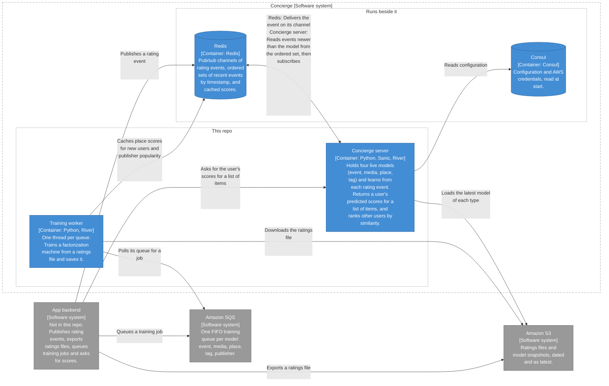
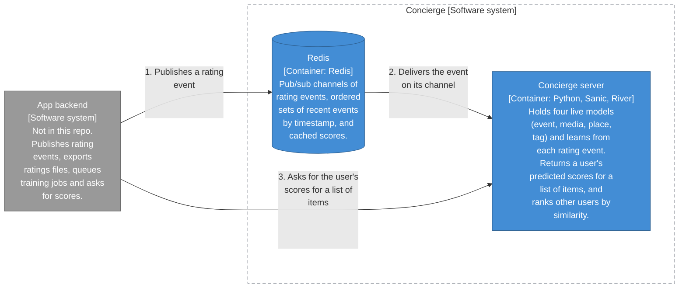
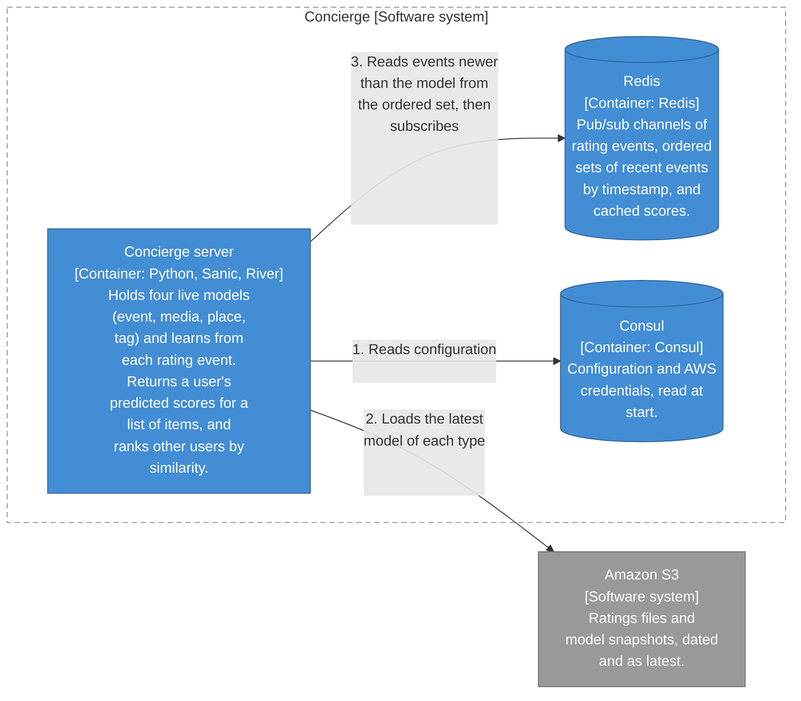
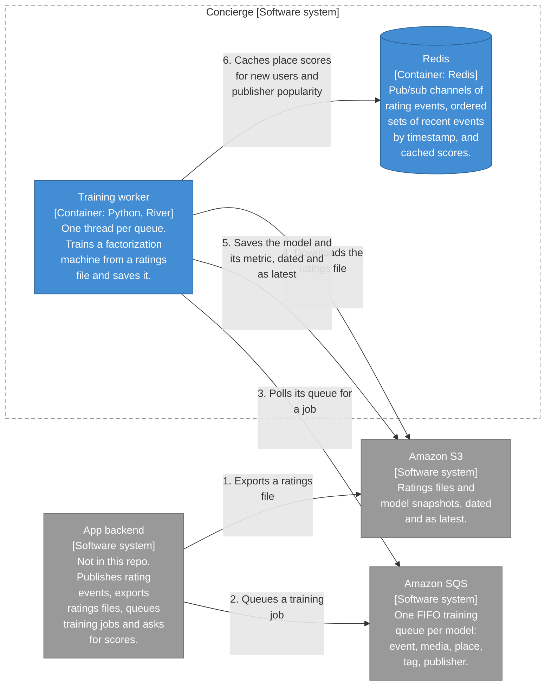
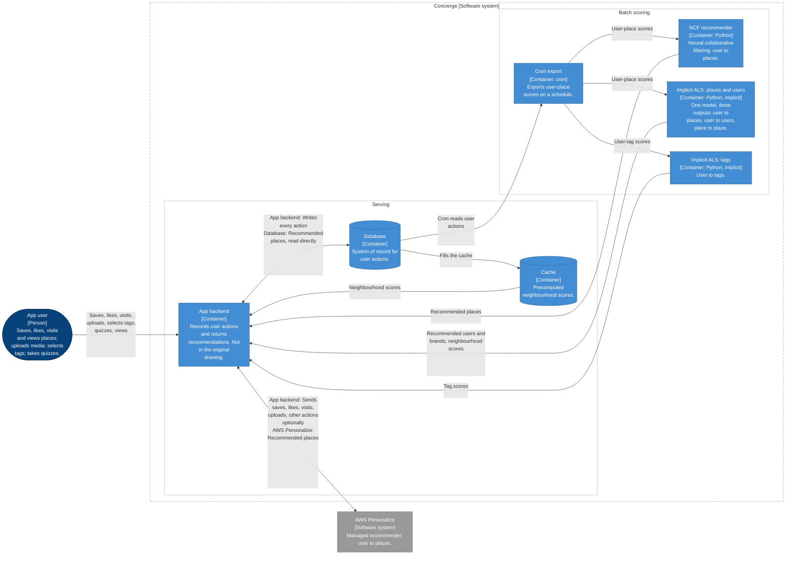
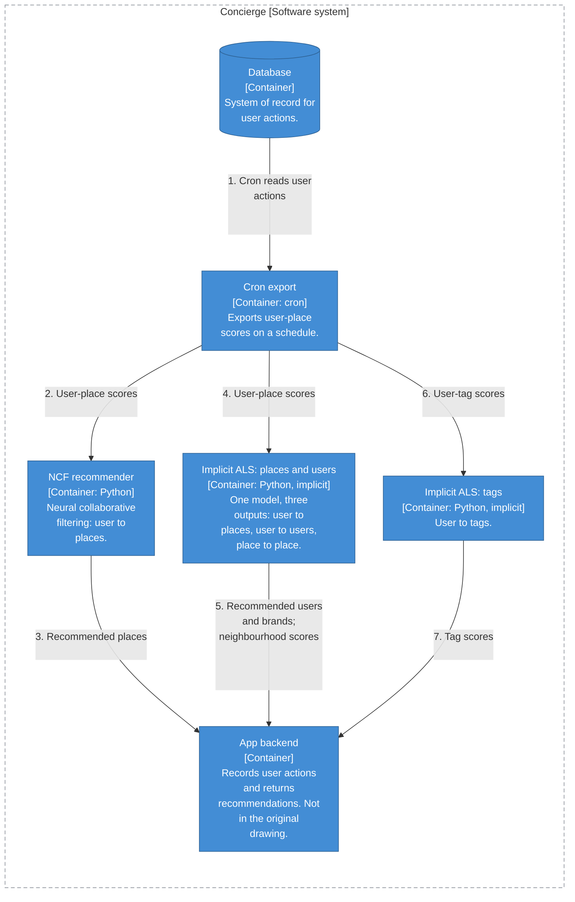

# concierge

A continuous learning collaborative filter<sup>1</sup> deployed with a light web server<sup>2</sup>. Distributed updates are live (real time pubsub + delta training from model snapshots). 

Live:  
- redis pubsub updates, and model persistence
- using redis ordered sets to take incremental trained models and augment them with the latest events

1. using [river-ml](https://riverml.xyz/)
2. using [sanic](https://sanic.readthedocs.io/)

## Architecture

The diagrams follow the [C4 model](https://c4model.com): blue boxes are the running parts of Concierge, grey boxes are systems it depends on. They describe what the code in this repo does. The app backend is not in this repo, so its arrows show what the code here expects of it.

### Containers



- **Concierge server** (`bin/server.py`): loads the latest model of each type from S3, replays the events newer than that model from a Redis ordered set, then keeps learning from each event published on Redis. It answers `/user/<id>/events`, `/media`, `/places` and `/tags` with predicted scores, and `/user/<id>/rankings/<users>` with user similarity.
- **Training worker** (`bin/training_queue.py`): one thread per SQS queue. A `train_recommendations` job names a ratings file in S3; the worker trains a factorization machine on it and saves the model and its metric to S3.
- A running server picks up a retrained model the next time it starts.

### Learning from one rating event



### Starting a server



### Retraining a model



<details>
<summary>The same model as a Structurizr workspace</summary>

Paste into [Structurizr](https://structurizr.com) to get context, container and dynamic views.

```
workspace "Concierge" "Real-time recommendation scores from models that keep learning: each rating event updates a live model, and scheduled retraining replaces it." {

    model {
        s_backend = softwareSystem "App backend" "Not in this repo. Publishes rating events, exports ratings files, queues training jobs and asks for scores." "External"
        s_s3 = softwareSystem "Amazon S3" "Ratings files and model snapshots, dated and as latest." "External"
        s_sqs = softwareSystem "Amazon SQS" "One FIFO training queue per model: event, media, place, tag, publisher." "External"
        sys = softwareSystem "Concierge" "Real-time recommendation scores from models that keep learning: each rating event updates a live model, and scheduled retraining replaces it." {
            group "This repo" {
                c_server = container "Concierge server" "Holds four live models (event, media, place, tag) and learns from each rating event. Returns a user's predicted scores for a list of items, and ranks other users by similarity." "Python, Sanic, River"
                c_worker = container "Training worker" "One thread per queue. Trains a factorization machine from a ratings file and saves it." "Python, River"
            }
            group "Runs beside it" {
                c_redis = container "Redis" "Pub/sub channels of rating events, ordered sets of recent events by timestamp, and cached scores." "Redis" "Database"
                c_consul = container "Consul" "Configuration and AWS credentials, read at start." "Consul" "Database"
            }
        }

        s_backend -> c_redis "Publishes a rating event"
        c_redis -> c_server "Delivers the event on its channel"
        s_backend -> c_server "Asks for the user's scores for a list of items"
        c_server -> c_consul "Reads configuration"
        c_server -> s_s3 "Loads the latest model of each type"
        c_server -> c_redis "Reads events newer than the model from the ordered set, then subscribes"
        s_backend -> s_s3 "Exports a ratings file"
        s_backend -> s_sqs "Queues a training job"
        c_worker -> s_sqs "Polls its queue for a job"
        c_worker -> s_s3 "Downloads the ratings file"
        c_worker -> c_redis "Caches place scores for new users and publisher popularity"
    }

    views {
        systemContext sys "context" {
            include *
            autoLayout lr
        }
        container sys "containers" {
            include *
            autoLayout lr
        }
        dynamic sys "v_live" "Learning from one rating event" {
            s_backend -> c_redis "Publishes a rating event"
            c_redis -> c_server "Delivers the event on its channel"
            s_backend -> c_server "Asks for the user's scores for a list of items"
            autoLayout lr
        }
        dynamic sys "v_start" "Starting a server" {
            c_server -> c_consul "Reads configuration"
            c_server -> s_s3 "Loads the latest model of each type"
            c_server -> c_redis "Reads events newer than the model from the ordered set, then subscribes"
            autoLayout lr
        }
        dynamic sys "v_train" "Retraining a model" {
            s_backend -> s_s3 "Exports a ratings file"
            s_backend -> s_sqs "Queues a training job"
            c_worker -> s_sqs "Polls its queue for a job"
            c_worker -> s_s3 "Downloads the ratings file"
            c_worker -> s_s3 "Saves the model and its metric, dated and as latest"
            c_worker -> c_redis "Caches place scores for new users and publisher popularity"
            autoLayout lr
        }
        styles {
            element "Person" {
                shape Person
                background #08427b
                color #ffffff
            }
            element "Software System" {
                background #1168bd
                color #ffffff
            }
            element "Container" {
                background #438dd5
                color #ffffff
            }
            element "Component" {
                background #85bbf0
                color #000000
            }
            element "External" {
                background #999999
                color #ffffff
            }
            element "Database" {
                shape Cylinder
            }
            element "Queue" {
                shape Pipe
            }
        }
    }
}
```

</details>

### Before this: the 2020 batch system

Concierge replaced an earlier design that scored in batch beside AWS Personalize. None of it is in this repo; the view below is redrawn from the original design diagram, and the app backend box is added so the user has something to talk to.



#### Batch recommendations



Released under the MIT License
